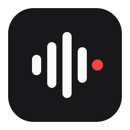
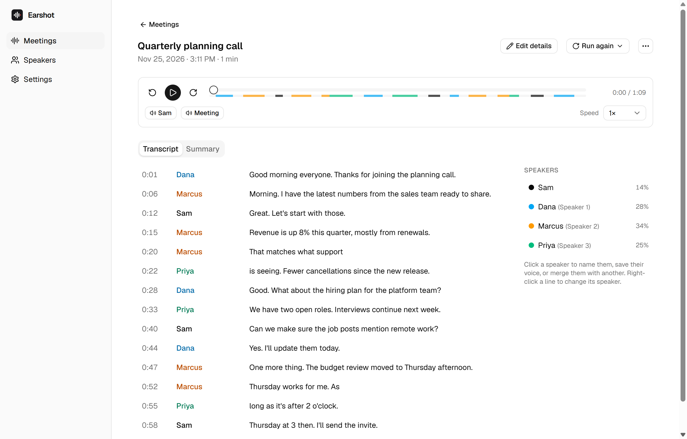
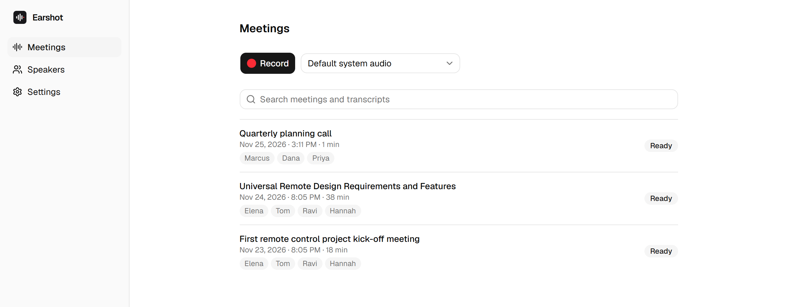

  

<h1 align="center">Earshot</h1>

  Record your calls, get searchable transcripts with every speaker labelled, and a summary of what was decided, all on your own machine. 
  Windows · Mac (Apple Silicon and Intel) · by Distraction Digital

  

---

Earshot is a meeting recorder for people who would rather be in the conversation than taking notes about it. Start a recording from the app, the tray or a keyboard shortcut, and Earshot keeps your microphone and the meeting's audio as separate tracks. When you stop, it transcribes them, works out who said what, and writes a summary with the decisions and action items.

It works with any call app (Zoom, Teams, Meet, Discord, a phone on speaker) because it records the audio on your computer, with no bot joining the call. And everything happens on your own computer: speech recognition, speaker detection and summaries all run locally on your graphics card or processor. Your recordings and transcripts stay on your machine, unless you choose to keep them in a cloud folder of your own. There are no accounts, no subscriptions and no per-minute fees.

## Features

- **Recording:** your mic and the meeting audio as two tracks, from all system audio or a single app (Windows). A small floating recorder shows levels and warns you if the mic or meeting stays silent, and you can switch either source mid-recording without a break. A global shortcut starts and stops recording from any app. Recordings are written safely as they happen: if the app or computer crashes, everything up to that moment is kept and you can carry on where you left off.
- **Transcription:** OpenAI's Whisper models, from Tiny to Large V3, with a recommendation for your hardware. Word-level timing, many languages, and GPU acceleration (NVIDIA, AMD, Intel or Apple) with an automatic fallback to the processor.
- **Speakers:** everything from your mic is you; the meeting audio is split into its separate voices. Rename, merge and reassign speakers, and save a voice so Earshot suggests that person's name in future meetings.
- **Review:** an audio player synced to the transcript. Click any word to hear it, correct the text in place, and mute either track. Search across every meeting, and export transcripts to Markdown, text, SRT, VTT or JSON, and audio as separate lossless tracks or a single mix (FLAC or MP3).
- **Summaries:** a local AI model (Qwen) writes a summary, decisions, action items and open questions as soon as the transcript is ready. Choose from templates for general meetings, client calls, interviews, one-on-ones and brainstorms, or write your own. Untitled meetings get a short title automatically.
- **Your files:** each meeting is a plain folder with its audio, a `meeting.json` holding the transcript, speakers and summary, and a readable `Transcript.md`. Put the recordings folder in Nextcloud, Google Drive, Dropbox, OneDrive or iCloud Drive and every computer running Earshot shows the same meetings, with edits and deletions carried across.
- **Calm by design:** light and dark themes, keyboard shortcuts throughout, and a guided first run that downloads the right models for your computer.

  

## Private by default

- **Local.** Recording, transcription, speaker detection and summaries all run on your computer. Nothing is uploaded and nothing is processed in a data center.
- **No tracking.** No accounts, analytics or telemetry. Logs stay on your computer.
- **Little internet use.** The only connections are model downloads you choose (from pinned sources with verified checksums) and a check for new versions of Earshot on GitHub, which you can turn off.
- **Be considerate.** Recording laws differ by place. Let people know when you record them; Earshot can remind you.

## Download

Installers are on the [Releases](https://github.com/distractiondigital/earshot/releases) page.

| | Installer | Notes |
|---|---|---|
| **Windows 10/11** | `Earshot_<version>_x64-setup.exe` | Uses any graphics card through Vulkan (NVIDIA, AMD or Intel), or the processor. |
| **Windows 10/11, NVIDIA** | `Earshot_<version>_x64-cuda-setup.exe` | Fastest on GeForce RTX 20-series and newer (driver 580 or newer). A larger download because it includes NVIDIA's CUDA libraries. |
| **Mac** | `Earshot_<version>_universal.dmg` | Apple Silicon and Intel. Recording meeting audio needs macOS 14.6 or newer; older versions record the mic only. |

Both Windows installers install the same app with the same data, so you can switch by installing the other one. Each keeps itself up to date with its own kind.

**Models** are downloaded inside the app, on first run or from Settings: about 1.6 GB for speech recognition and speaker detection, and 1.2 to 5.3 GB for an optional summary model.

### Installing an unsigned build

Earshot isn't code-signed yet, so your computer warns you the first time:

- **Windows:** on "Windows protected your PC", click **More info → Run anyway**.
- **Mac:** open the app once, then go to **System Settings → Privacy & Security** and click **Open Anyway** (or right-click the app in Finder and choose **Open**). Earshot then asks for microphone access, and for audio capture the first time you record meeting audio.

## Documentation

- [Development](docs/DEVELOPMENT.md): running from source, building installers, releases

## Credits

Earshot builds on open work, most of all [whisper.cpp](https://github.com/ggml-org/whisper.cpp) and OpenAI's [Whisper](https://github.com/openai/whisper) models (speech recognition), [sherpa-onnx](https://github.com/k2-fsa/sherpa-onnx) with [pyannote](https://github.com/pyannote/pyannote-audio) and [3D-Speaker](https://github.com/modelscope/3D-Speaker) models (telling speakers apart), [llama.cpp](https://github.com/ggml-org/llama.cpp) with the [Qwen](https://github.com/QwenLM) models (summaries), [Tauri](https://tauri.app) and [React](https://react.dev).

The full list, with licenses, is in [CREDITS.md](CREDITS.md) and under **Settings → About** in the app. Every package that ships with Earshot, with its license text, is in [THIRD_PARTY_LICENSES.md](THIRD_PARTY_LICENSES.md).

Earshot was designed by a filmmaker, not a software developer. It was built with AI as a tool, so you can stay present in your conversations and then get back to being creative. We believe AI should be local-first wherever possible. That's why Earshot never sends your information to a data center, and why it will always be open and free.

## License

© 2026 Distraction Digital. Earshot is free and open source software under the [MIT License](LICENSE).
